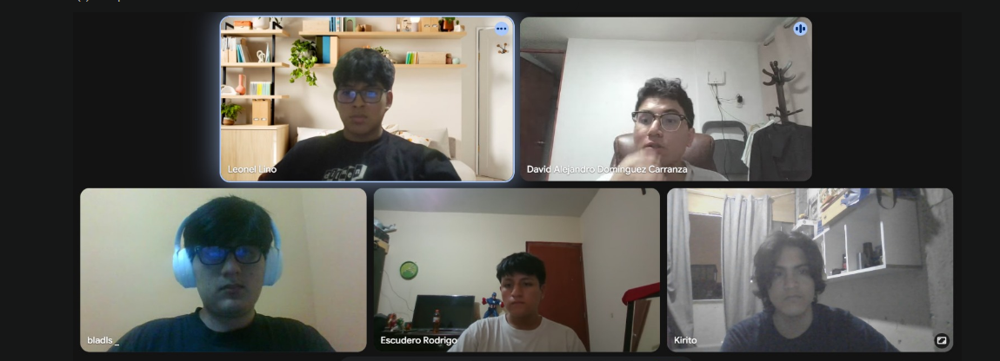

# Sistema de Gestión de Trámites – Centro de Salud Materno Infantil Tahuantinsuyo Bajo

**Curso:** Fundamentos de Programación (CIIN1205P) – UPN  
**Docente:** Mg. Cinthia Jeanette Calderon Aquiño  
**Equipo 2**

## Descripción

Sistema de consola desarrollado en **Python** para registrar y dar seguimiento a los trámites del Centro de Salud Materno Infantil Tahuantinsuyo Bajo (Independencia, Lima): SIS, referencias, certificados de salud y descanso médico.

Permite registrar, consultar, modificar y eliminar trámites (CRUD). Los datos se guardan en el **archivo de texto** `tramites.txt`, por lo que no se pierden al cerrar el programa. El trabajo se desarrolló con **control de versiones usando Git y GitHub**.

## Tecnologías

- Lenguaje: Python 3
- Editor: VS Code
- Control de versiones: Git y GitHub
- Almacenamiento: archivo de texto (`tramites.txt`)

## Estructura del proyecto

```
sistema-tramites-cmi-tahuantinsuyo-bajo/
├── main.py              # Menú principal y roles
├── tramite.py           # Clase Tramite (datos de un trámite)
├── autenticador.py      # Clase Autenticador (contraseña por rol)
├── gestor.py            # Clase GestorTramites (operaciones del sistema)
├── archivo_datos.py     # Guardar y leer trámites en archivo (tramites.txt)
├── tramites.txt         # Archivo donde se guardan los trámites
├── capturas/            # Capturas de cada avance
└── README.md
```

## Funcionalidades

- Registrar un trámite (DNI, nombres, apellidos, tipo) con validación de datos y cargo de recepción.
- Consultar un trámite por su código (búsqueda secuencial).
- Modificar el estado y el área de un trámite (solo Jefatura).
- Eliminar un trámite (solo Jefatura).
- Mostrar todos los trámites en una tabla, ordenados por apellido y nombre (método burbuja).
- Reporte del área de Archivo.
- Acceso con contraseña según el rol: Ventanilla, Jefatura o Archivo.
- **Guardar y leer desde archivo:** cada cambio se guarda en `tramites.txt` y se lee al iniciar el programa.

### Roles y permisos

| Rol | Registrar | Consultar | Modificar | Eliminar | Reporte Archivo | Mostrar |
|---|---|---|---|---|---|---|
| Ventanilla | Sí | Sí | No | No | Sí | Sí |
| Jefatura | Sí | Sí | Sí | Sí | Sí | Sí |
| Archivo | No | Sí | No | No | Sí | Sí |

## Evidencias

Cada captura prueba una versión del proyecto y está guardada en la carpeta `capturas/`.

| Versión | Qué se muestra | Captura |
|---|---|---|
| v1.0 Estructura inicial | Commit en GitHub con los archivos base | [v1.0.png](capturas/v1.0.png) |
| v1.1 Clase Tramite | Commit de `tramite.py` | [v1.1.png](capturas/v1.1.png) |
| v1.2 Autenticador | Commit de `autenticador.py` | [v1.2.png](capturas/v1.2.png) |
| v1.3 Guardar y leer en archivo | Commit de `archivo_datos.py` | [v1.3.png](capturas/v1.3.png) |
| v1.4 Gestor: registrar y búsqueda secuencial | Commit de `gestor.py` | [v1.4.png](capturas/v1.4.png) |
| v1.4.1 Gestor: consultar, modificar, eliminar, ordenar, mostrar y reportar | Commit de `gestor.py` | [v1.4.1.png](capturas/v1.4.1.png) |
| v1.5 Menú principal | Programa ejecutándose (menú) | [v1.5.png](capturas/v1.5.png) |
| v1.6 Documentación | README visto en GitHub | [v1.6.png](capturas/v1.6.png) |
| v2.0 Versión final | Programa guardando y leyendo datos | [v2.0.png](capturas/v2.0.png) |

### Foto del equipo

**Lugar:** Reunión por la plataforma Meet  
**Fecha:** 19/10/2026



**Integrantes en la foto:** Cayao Villafranca Josue Emanuel, Dominguez Carranza David Alejandro, Gomez Perales Juhen Jeriel, Escudero Arrunategui Eberth Rodrigo y Lino Cholan Leonel Anderson.

## Integrantes

| Integrante | Responsabilidad |
|---|---|
| Dominguez Carranza David Alejandro | Segunda parte del gestor (consultar, modificar, eliminar, ordenar, mostrar y reporte) |
| Lino Cholan Leonel Anderson | Menú principal |
| Cayao Villafranca Josue Emanuel | Estructura inicial, clase Tramite y primera parte del gestor (registrar y búsqueda) |
| Gomez Perales Juhen Jeriel | Autenticador (acceso por rol) |
| Escudero Arrunategui Eberth Rodrigo | Guardar y leer en archivo |

## Repositorio

https://github.com/Bladls/sistema-tramites-cmi-tahuantinsuyo-bajo